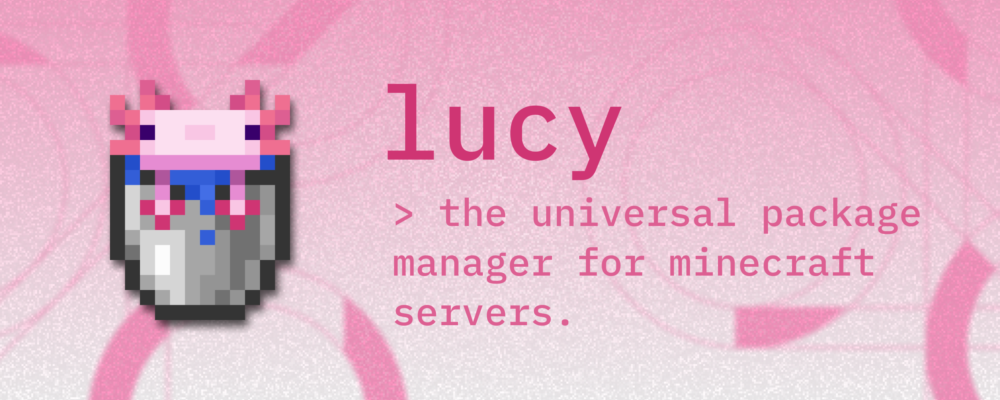

<div align="center">
  

# Lucy

**The package manager for Minecraft servers.**

[](https://github.com/mclucy/lucy/actions/workflows/ci.yml)
[](https://raw.githack.com/wiki/mclucy/lucy/dev/coverage.html)
[](LICENSE)

[Documentation](https://lucy.lc/docs) | [English](README.md) | [中文](README_CN.md)
</div>

> [!IMPORTANT]
> Lucy is in active pre-beta development. APIs and schemas may change before `v0.1.0`. Join
the [QQ Group](https://qm.qq.com/q/Sf65NVYaAi) or open an [issue](https://github.com/mclucy/lucy/issues/new) to
contribute.

Lucy brings modern package management experience to Minecraft servers. Define and manage your server with simple and
declarative workflows.

We (are working to) support multiple ecosystems, and their combinations:

- Fabric
- Forge
- NeoForge
- MCDReforged
- Bukkit/Spigot/Paper

Lucy fetches metadata and artifacts from multiple sources:

- Modrinth
- CurseForge
- Host your own on GitHub!

## Installation

```bash
# Homebrew (macOS / Linux)
brew install --HEAD mclucy/tap/lucy

# Go
go install github.com/mclucy/lucy@latest
```

Pre-built binaries are available on [Releases](https://github.com/mclucy/lucy/releases).

## Quickstart

```bash
# Generate lucy.yaml for an existing server directory
lucy init

# Add packages with dependency resolution
lucy add modrinth:fabric-api modrinth:lithium

# Inspect the live server
lucy status

# Sync the server as defined by the manifest file
lucy install
```

`lucy.yaml` records what you want. `lucy-lock.yaml` records the exact artifact that satisfies it, hash included. Commit
both: `lucy install` reproduces the server from the lock alone, and `--locked` fails the build if the two have drifted
apart.

## Commands

| Command                | Usage                                                                                              |
|------------------------|----------------------------------------------------------------------------------------------------|
| `lucy init`            | Generate `lucy.yaml` and `lucy-lock.yaml` from an existing server directory                       |
| `lucy add <pkg>...`    | Record requirements, resolve the closure, update the lock, and sync                                |
| `lucy remove <pkg>...` | Drop requirements, re-resolve, and prune artifacts nothing needs                                   |
| `lucy install`         | Converge the server with the lock; re-resolve when stale, with `--locked` and `--offline` controls |
| `lucy status`          | Show the live server identity, files, and packages; `--from-lock` renders the lock                 |
| `lucy search <query>`  | Search Modrinth, CurseForge, Hangar, Spiget, and the MCDReforged catalogue                         |

Full guides, configuration, and flags: **[lucy.lc/docs](https://lucy.lc/docs)**

---

> [!NOTE]
> The logo and axolotl pixel art are copyright Mojang AB. Original replacements are in progress.
